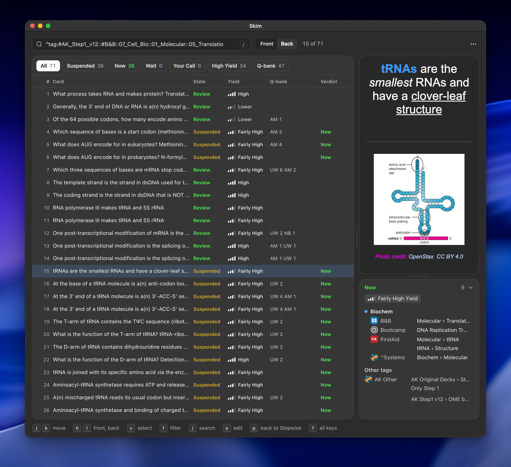

# Skim

**A card browser for Anki that keeps up with your keys, and helps you decide
what to unsuspend.** Search with Anki's own syntax, then move through the
cards with vim keys. Each card looks the way it does when you review it, and
the next ones are drawn before you get there, so moving is instant. On a
topic, each suspended card says whether to unsuspend it now or wait for the
system it mostly belongs to, and why.

It pairs with [Stepwise](https://github.com/AIbrahimv2/AnkiStepwise): press
`b` on a topic there to see its cards here, and Skim follows as you move
through topics.



## Features

- **Instant moves.** While you read a card, Skim draws the next ones (and the
  other side of this one) in the background. Pressing `j` then only swaps
  which one shows: about one screen refresh. Anki's own preview redraws on
  every move and waits at least 300 ms between them.
- **Cards as you review them.** Each card is drawn in a copy of Anki's
  reviewer page, with its note type's styling and scripts, images, MathJax and
  play buttons.
- **Vim keys.** `j`/`k` to move, a number first to move that many (`10j`),
  `gg`/`G` and `25G` to jump, `Ctrl-d`/`Ctrl-u` for half a page, `h`/`l` or
  Space for the front and back, `/` to search. Arrow keys, Home and End work
  too.
- **Laid out like Anki's browser.** A table of the cards on the left, the card
  on the right, and where it lives under it. Drag the edge between the table
  and the card, or between the card and its tags, to resize them
  (double-click one to reset it, or choose **⋯ → Reset layout** for all of
  it). A narrow table drops the columns it has least room for (Deck first,
  then Again in, Q-bank and Yield), so the card can take most of the window.
  Click a row to jump there.
- **Columns that help you decide.** The note's text with clozes filled in, its
  deck (for a card in a filtered deck, its home deck in brackets; hover for
  the full name), its state (new, learning, review, suspended, buried),
  AnKing's yield tag, the
  UWorld, AMBOSS and NBME questions tagged on it, the other systems it comes up
  in ("Again in", coloured by what you've done in Stepwise), and a verdict.
  Click a column's title to sort by it (again to reverse it).
- **Now or wait.** On a topic (from Stepwise, or a `tag:` search), each
  suspended card gets a verdict. Its places in your pinned resources (and the
  one you're on) are sorted by system: if at least half are in this topic's
  system, unsuspend it now; if not, and a system you haven't started also has
  it, it could wait, since you'll meet it there. High-yield cards that would
  wait are "your call", and a card tagged here only as `::Extra` leans to
  waiting. The reason shows beside it ("43% here; comes up again in Endocrine,
  Repro"). The threshold is a setting.
- **Filters.** All, Suspended, Now, Wait, Your call, High yield and Q-bank, each
  with its count. Click one, or press `f` / `F` to go through them.
- **Where this card lives.** Under the card, its tags grouped by resource: the
  one you're on first, then your pinned resources in Stepwise's order, each
  place with its Stepwise status. Places in other systems are marked with
  theirs, so you can see where you'll meet the card again. Its other tags
  (other resources, AnKing's own) follow, grouped the same way with readable
  names, and fold into "Show more" only when they don't fit; a card can have
  60 of them. The groups spread into columns when the pane is wide. Click
  its title, or press `i`, to hide it and give the card its room.
- **Follows Stepwise.** Press `b` (or `p`) on a topic in Stepwise and Skim
  opens on its cards. Leave Skim open and every topic you move to in Stepwise shows its
  cards here, without taking the keys away. `p` in Skim goes back to Stepwise.
  Search for something else in Skim and it stops following.
- **From a review.** Press Cmd/Ctrl+Shift+B while reviewing and Skim opens on
  today's review of the deck: the cards you've studied so far, in the order
  you answered them, the card on screen (where it starts), then the cards
  still to come, in the order Anki will show them. It shows the side the
  reviewer is on: the front until you've shown the answer, then the back. The
  list doesn't give away answers you haven't seen: a card still to come shows
  its front, with its cloze as `[...]` (or its hint). Leave Skim open and it
  follows the review, flipping when you do; `p` goes back to the review.
- **Views.** A bar over the table switches between All (your search, or
  Stepwise's topic), This review and Anki's browser's "Today" searches: Due,
  Added, Edited, Studied, First review, Rescheduled, Again and Overdue, each
  with its count. They're on the deck you're reviewing, or else the one
  selected in Anki. Click one or press `t` / `T` (or `H` / `L`). Skim opens on
  All, or on This review during a review. While it follows a review it keeps
  the view you picked (studied cards in the order you studied them).
- **Edit in Anki's browser.** `e` opens the card there, with the same search.
- **Follows Anki's light and dark themes**, and looks like Stepwise.

## Usage

1. Open **Tools → Skim** (Cmd/Ctrl+Shift+B), or press `b` on a topic in
   Stepwise. During a review, the same shortcut opens Skim on today's review,
   at the card you're on.
2. Press `/`, type a search the way you would in Anki's browser
   (`tag:Cardio`, `deck:current is:suspended`, `heart`), and press Enter.
3. Move with `j` and `k`. `l` shows the back, `h` the front.

### Keys

| Keys | Does |
| --- | --- |
| `j` / `k` | Next / previous card (arrow keys too) |
| `10j` / `8k` | Move that many cards |
| `gg` / `G` | First / last card |
| `25G` or `25gg` | Card 25 |
| `Ctrl-d` / `Ctrl-u` | Half a page down / up; a number first sets how far, from then on |
| `Ctrl-f` / `Ctrl-b` | A page down / up (Page Down / Page Up too) |
| `h` / `l` | Show the front / the back |
| `Space` | Flip the card |
| `J` / `K` | Scroll a long card down / up |
| `i` | Hide or show the tags under the card |
| `v` | Select cards as you move (`j`, `k`, `10j`, `G`, ...); `v` or `Esc` stops |
| `Shift-↓` / `Shift-↑` | Select as you move, as in Anki's browser (Shift-click too) |
| `Cmd-J` (`Ctrl-J`) | Suspend the selected cards, or the one you're on; unsuspend them if they all are |
| `f` / `F` | Next / previous filter |
| `t` / `T` | Next / previous view (All, This review, Due, Studied, ...) |
| `H` / `L` | The view to the left / right |
| `/` | Search; Enter runs it, Esc goes back to the cards |
| `e` or `B` | Open the card in Anki's browser, to edit it |
| `r` | Play the card's audio |
| `p` | Back to the window that opened Skim (Stepwise) |
| `q` or `Esc` | Close Skim (Esc first cancels a number you've typed, or ends a selection) |
| `?` | Show these keys |

### Settings

**⋯ → Settings…** in the window (Anki's **Config** button for the add-on
opens the same thing): the side each card opens on (the back, by default,
which for most note types includes the front), playing audio by itself, when
a card could wait (less than half its places in the topic's system, by
default), the search Skim opens on the first time, and the keyboard shortcut.

### For other add-ons

Skim publishes a small API as `aqt.mw.skim` (see [src/api.py](src/api.py)):
`open()` shows a search or a list of card ids, and `follow()` swaps in new
cards while Skim shows yours. Passing card ids skips Anki's search, which
for a tag reads every note. Passing a `topic` says what to read the cards'
tags against, and `set_context()` lets a study planner (Stepwise) say which
resources are pinned and what you've done.

## Installation

From [AnkiWeb](https://ankiweb.net/shared/info/2141626960): in Anki, open
**Tools → Add-ons → Get Add-ons** and paste the code `2141626960`. It needs
Anki 24.04 or newer. Or download `skim.ankiaddon` from the
[latest release](https://github.com/AIbrahimv2/AnkiSkim/releases/latest) and
double-click it.

## Development

The add-on that Anki loads lives in `src/`. To try changes live, link it
into your Anki add-ons folder and restart Anki:

```bash
ln -s "$(pwd)/src" ~/Library/Application\ Support/Anki2/addons21/anki-skim
```

The window's page is TypeScript in `web/`, built with Vite into
`src/web/skim.js` and `skim.css` (committed, so the add-on works straight from
a checkout). The parts you move through (list, card frames, keys) are plain
DOM; the dialogs, menu and toasts are React, with styles and controls copied
from Stepwise. It talks to Python through Anki's `pycmd` bridge
(`src/bridge.py`).

```bash
cd web && npm install
npm run build        # rebuild src/web/ after changing the page
npm test             # the vim keys
```

To work on the page with **real cards**, run the dev server with Anki's own
Python. It copies the collection to a temp folder, only reads the media
folder, and loads Anki's reviewer files from the installed app:

```bash
PY=$(ls -d ~/Library/Application\ Support/AnkiProgramFiles/python/*/bin/python3 | tail -1)
"$PY" tools/devserver.py --collection ~/Library/Application\ Support/Anki2/User\ 1/collection.anki2 \
  --media ~/Library/Application\ Support/Anki2/User\ 1/collection.media --search "tag:Cardio"
# then open http://127.0.0.1:5183
```

The tests run with Anki's Python against a small collection they make up:

```bash
./tests/run.sh                  # all of them, or name some: ./tests/run.sh test_window
```

`tools/bench_display.py` times how fast cards get on screen, swapping one
page's HTML against switching between frames drawn ahead. That's how Skim
ended up drawing ahead.

## License

[AGPL-3.0-or-later](LICENSE).
