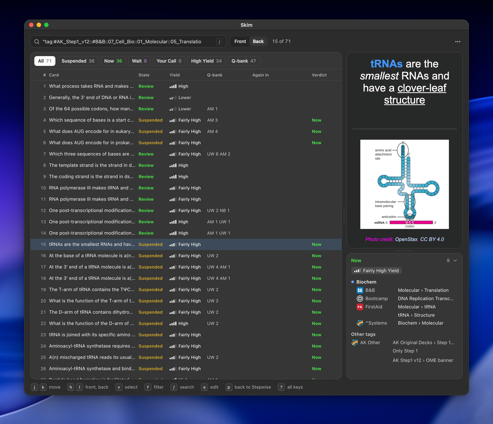

# AnkiWeb listing

What's in the AnkiWeb add-on form (https://ankiweb.net/shared/upload?id=2141626960).
Keep this in step with the live listing
(https://ankiweb.net/shared/info/2141626960); the release steps are in the
`anki-addon-release` skill (see CLAUDE.md). Skim was first uploaded on
2026-11-17 (AnkiWeb says 2026-11-18, in UTC), as a new add-on, which got
the ID 2141626960.

## Package on AnkiWeb

Version 1.0.0, uploaded 2026-11-17. The release script (`release.py --uploaded`
in the `anki-addon-release` skill) updates this line after each upload.

## Title

👀 Skim: a fast vim-key card browser that says what to unsuspend

## Tags

card browser browse cards vim keys keyboard navigation hjkl fast preview card preview unsuspend cards suspended cards what to unsuspend anking step 1 step1 usmle comlex boards and beyond b&b bootcamp first aid stepwise

## Support page

https://github.com/AIbrahimv2/AnkiSkim/issues

## Supported Anki versions

Minimum 24.04, maximum 26.09.4 with no `-`, so newer versions get it too.
Anki says the code is invalid to anyone below the minimum.

Why 24.04: it's the oldest version Stepwise and Exam Timeline are listed
for, the first whose Mac, Windows and Linux builds all ship Qt 6.6
(Chromium 112, which the kit's `color-mix()` colours need), and Skim's
tests pass on it: `tests/run_on_anki.sh 24.4` ran all four (bridge, cards,
tags, and the real window offscreen) on 2026-11-17. Rerun it on the minimum
before each release.

## Screenshot

`docs/screenshot.png`, made by `tools/screenshots.py` with the add-ons'
shared screenshot tools: Skim's window on the B&B Translation topic from the
Default profile's collection (a copy), with Stepwise's pinned resources, at
the tRNA card (a clover-leaf diagram, OpenStax, CC BY 4.0, credited on the
card), which it says to unsuspend now. The window is 1180x970, taller than
its default, so the diagram and its credit show whole. Chosen on 2026-11-17
from the B&B cards with openly licensed images: most cards' large text
pushes their picture out of the card pane, and many topics have no
suspended cards left to show verdicts. Rerun it after the window changes.

## Description

Paste as is. AnkiWeb takes Markdown and basic HTML. It follows the layout in
the `anki-addon-release` skill's listing conventions: what it does, the code
line and the screenshot first, the signature last. The first upload went
without the code line, since AnkiWeb gives the ID on the first save, and a
second save added it.

```markdown
A card browser for Anki that keeps up with your keys, and helps you decide what to unsuspend. Search with Anki's own syntax, then move through the cards with vim keys. Each card looks the way it does when you review it, and the next ones are drawn before you get there, so moving is instant. On a topic, each suspended card says whether to unsuspend it now or wait for the system it mostly belongs to, and why.

**Code: 2141626960.** Paste it in Anki under **Tools → Add-ons → Get Add-ons**.

<p></p>

**Features**

- **Instant moves.** While you read a card, Skim draws the next ones in the background, so moving takes about one screen refresh. Anki's own preview waits at least 300 ms between cards.
- **Cards as you review them**, with their note type's styling, images, MathJax and audio.
- **Vim keys:** `j`/`k`, counts like `10j` and `25G`, `gg`/`G`, `Ctrl-d`/`Ctrl-u`, `h`/`l` or Space for the front and back, `/` to search. Arrow keys work too.
- **Now or wait.** On a topic, each suspended card says whether to unsuspend it now or wait for the system it mostly belongs to, and why ("43% here; comes up again in Endocrine, Repro").
- **Columns to decide by:** state, AnKing yield, UWorld, AMBOSS and NBME questions, and the other systems a card comes up in. Filter to Suspended, Now, Wait, High yield or Q-bank.
- **Select and suspend:** `v` selects cards as you move, and Cmd/Ctrl+J suspends them, as in Anki's browser.
- **From a review:** Cmd/Ctrl+Shift+B opens Skim on today's review at the card you're on, without giving away answers you haven't seen.
- **Views** for Anki's "Today" searches: Due, Added, Studied, Again and more.
- **Pairs with [🪜 Stepwise](https://ankiweb.net/shared/info/1949793886):** press `b` on a topic there to see its cards here, and Skim follows as you move through topics.

Open it from **Tools → Skim** (Cmd/Ctrl+Shift+B). Press `?` in the window for every key.

Source, changelog and issues: [github.com/AIbrahimv2/AnkiSkim](https://github.com/AIbrahimv2/AnkiSkim)

<p><a href="https://abdelrahmanibrahim.com/anki/"></a></p>
```
